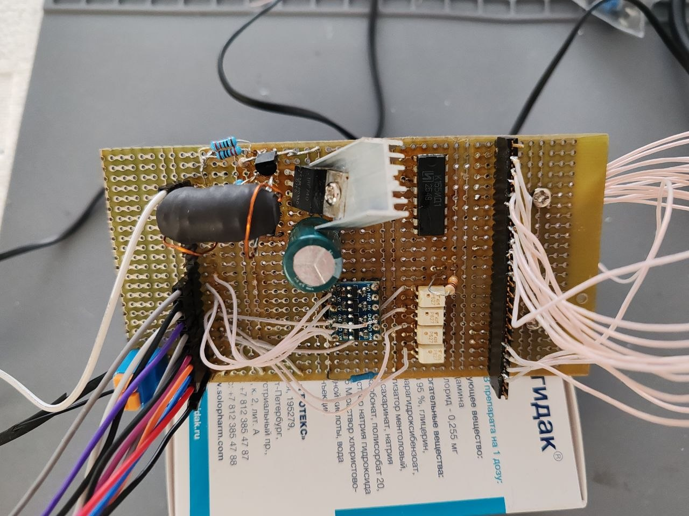

# STM32 Газоразрядные часы (ИН-14Б) с динамической индикацией

Проект часов на микроконтроллере STM32F411CEU6. Устройство управляет четырьмя газоразрядными индикаторами (ИН-14Б), отображая текущее время в формате ЧЧ:ММ (например, 12:34) одновременно на всех разрядах с помощью динамической индикации.

## Фото готового устройства

## 🛠️ Аппаратная часть

  * **Микроконтроллер:** STM32F411CEU6 (Black Pill)
  * **Устройства:** 4 газоразрядные лампы (ИН-14Б) с дешифратором К155ИД1.
  * **Управление катодами (P0-P3):** Пины `PB0`, `PB1`, `PB2`, `PB3` (подача двоичного кода 0-9).
  * **Управление анодами (Разрядами):** Пины `PB4`, `PB5`, `PB6`, `PB7`.
  * **Питание:** Используется boost-преобразователь (управляется через ШИМ `TIM2` на 100 кГц с пина `PA0`) для обеспечения высокого напряжения (~170 В) на лампах.

## 📂 Структура проекта

  * `Core/Src/main.c` — основной файл с логикой часов, мультиплексирования и обработкой прерываний.
  * `Core/Src/tim.c` — настройка таймеров (ШИМ, время, дисплей).
  * `Core/Src/gpio.c` — настройка портов ввода-вывода.
  * `cmake/` — файлы конфигурации сборки CMake.
  * `indicator12b_clock.ioc` — файл конфигурации STM32CubeMX.

## 🧠 Логика работы

  1. **Инициализация:** Настройка тактирования (PLL на 100 МГц), портов GPIO и запуск трех таймеров:
     * `TIM2` — генерация ШИМ для повышающего преобразователя.
     * `TIM3` — прерывание раз в секунду для счета времени.
     * `TIM4` — прерывание каждые 2 мс для динамической индикации.
  2. **Счет времени:** По прерыванию `TIM3` инкрементируются переменные `hours`, `minutes`, `seconds`. Значения раскладываются на отдельные цифры в массив `digits[4]`.
  3. **Динамическая индикация:** По прерыванию `TIM4` происходит быстрое переключение разрядов (анодов). Программа подает код текущей цифры на дешифратор и зажигает соответствующую лампу.
  4. **Защита от аппаратных проблем:**
     * Перед подачей новой цифры все аноды гасятся.
     * Добавлена микро-пауза (пустой цикл `__NOP()`) для закрытия транзисторов, чтобы избежать сквозного тока и тусклого свечения («призраков» цифр).

## 🚀 Как собрать и прошить

  1. Откройте проект в **STM32CubeIDE** (или используйте VS Code с расширением STM32Cube).
  2. Убедитесь, что все пути к компилятору `arm-none-eabi-gcc` настроены корректно (в файле `CMakeLists.txt` или `settings.json`).
  3. Соберите проект (Build / F7).
  4. Подключите плату через ST-Link и прошейте микроконтроллер (Run / Debug / F11).

* * *

_Разработано в рамках изучения работы с STM32, импульсными преобразователями и динамической индикацией._
